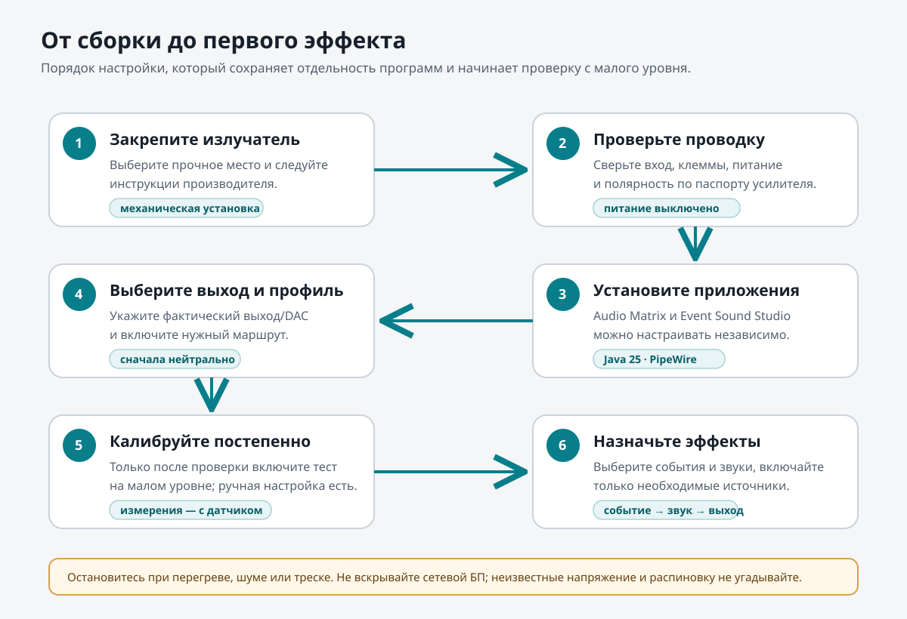
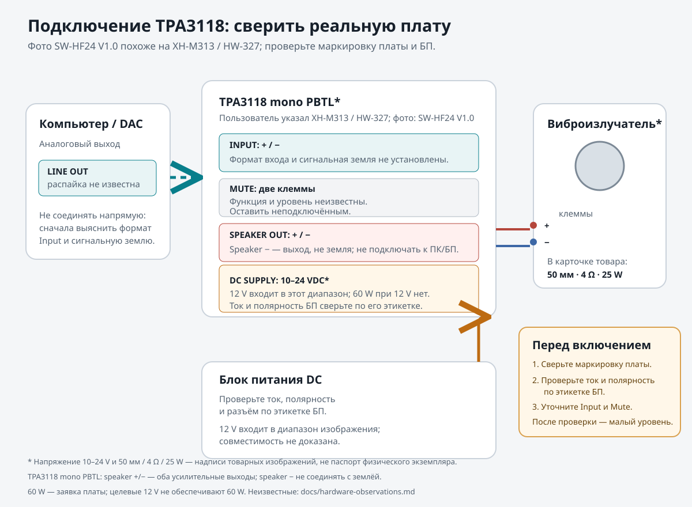

# Desk Haptics

Компактный DIY-проект для тактильной обратной связи на рабочем столе. Программы работают независимо и используют обычный аудиовыход компьютера: отдельный аудиосервер не нужен.

## Как проходит сигнал

**Событие → Event Sound Studio → PipeWire → Audio Matrix → выбранный выход → усилитель → излучатель → стол.** Event Sound Studio назначает эффект клавише, кнопке мыши или событию GNOME. Audio Matrix выбирает выход и, если оборудование и конфигурация это позволяют, применяет маршрут и фильтры. Каждое приложение можно запускать и настраивать отдельно.

## Что понадобится

- Компьютер с PipeWire и GNOME Wayland.
- Аудиокабель от аналогового выхода компьютера или внешнего USB DAC к линейному входу усилителя.
- Плата, обозначенная пользователем как `TPA3118 1 × 60 W XH-M313 / HW-327`; присланная плата `SW-HF24 V1.0` похожа по размеру и расположению клемм, но фактическую маркировку надо сверить. Излучатель — по его паспорту.
- Блок питания с подтверждёнными напряжением, полярностью и допустимым током.

### Что видно на присланных изображениях

Это сведения с пользовательских изображений товара, а не проверенные спецификации изготовителя. Подробная таблица наблюдений и нерешённых вопросов — в [docs/hardware-observations.md](docs/hardware-observations.md).

| Деталь | Надписи на изображении | Что это пока не подтверждает |
|---|---|---|
| Усилитель | Пользователь назвал `TPA3118 1 × 60 W XH-M313 / HW-327`; плата на иллюстрации `SW-HF24 V1.0`, `10–24 VDC`, `Input +/−`, speaker `+/−`, `Mute`, около 46 × 35 мм. Размер и клеммы похожи на продавцовские изображения XH-M313/HW-327 | физическая модель/ревизия, схема входа и Mute, ток БП и паспорт платы. `60 W` — продавцовский максимум; он не относится к работе от 12 V |
| Виброизлучатель | в карточке товара указаны `50 мм`, `4 Ω`, `25 W` | точную модель и паспорт, фактический импеданс и допустимую мощность |

12 V попадает в диапазон `10–24 VDC`, напечатанный на изображении платы, и в диапазон микросхемы TPA3118D2. Это не подтверждает ток/полярность конкретного БП и не даёт рекламные 60 W; максимальная мощность зависит от напряжения, нагрузки и исполнения платы. Сверьте фактическую плату и БП перед тестом. PBTL speaker `−` — выход усилителя, не земля.

## Подключение

1. Закрепите излучатель на прочной части стола по инструкции его производителя. Не сверлите стол до проверки места крепления и отсутствия скрытых кабелей.
2. Для показанной платы изображение обозначает двухконтактный вход `Input +/−`, однако формат входа и подключение общего провода не установлены. Не подключайте к нему кабель компьютера/DAC напрямую до проверки паспорта или схемы именно этой ревизии.
3. Изображение показывает speaker `+`/`−` и две клеммы `Mute`, но не описывает Mute. Оставьте его неподключённым. В mono PBTL оба speaker-провода являются выходами усилителя: не соединяйте speaker `−` с землёй компьютера/БП, входом или корпусом.
4. До включения сверьте физические обозначения платы, ток и полярность БП, аудиокабель и допустимую нагрузку. Изображение указывает 10–24 VDC, поэтому целевые 12 V находятся внутри этого диапазона; ток БП и 60 W при 12 V из этого не следуют.
5. После подтверждения совместимости включите систему с минимальным уровнем и постепенно увеличивайте его. Остановитесь при треске, перегреве, сильном шуме или необычном ходе излучателя.

**Не вскрывайте сетевой блок питания.** Для первичной проверки используйте малый уровень звука; не запускайте длительный тестовый тон на высокой громкости.

## Настройка

1. Установите и запустите приложения отдельно: [Audio Matrix](https://github.com/IlyaAndreev05/audio-matrix) и [Event Sound Studio](https://github.com/IlyaAndreev05/event-sound-studio).
2. Пользователь подтвердил, что виброизлучатель сейчас подключён к выходу `Линейный выход — Family 17h (Models 00h-0fh)`. Это сообщение не подтверждает активный маршрут Audio Matrix или схему усилителя. После проверки документации и физической проводки выберите фактический выход в Audio Matrix, назначьте ему роль `haptic_output`, шине событий — `effects`, затем выберите режим Haptic и создайте маршрут. Haptic пропускает только такие маршруты; без явной роли устройство не выбирается автоматически.
3. До проверки маркировки усилителя, источника питания, сигнального кабеля и полярности не включайте усилитель и не запускайте тестовый сигнал. После проверки в Event Sound Studio выберите звуки, настройте привязки и включите только нужные источники событий; доступ к устройствам ввода запрашивается отдельно и не требует запуска от root.
4. Только после подтверждения совместимости проверьте событие встроенной кнопкой теста на малом уровне. Начинайте с нейтральных фильтров; остановитесь при шуме, перегреве или необычном ходе излучателя.
5. Подстройте эффект и профиль на слух. Ручная калибровка доступна без дополнительных датчиков. Измерительная калибровка требует реального микрофона или акселерометра и сохраняет исходные измерения отдельно; приложение не подменяет их расчётной кривой.

Страницы загрузок: [релизы Audio Matrix](https://github.com/IlyaAndreev05/audio-matrix/releases) · [релизы Event Sound Studio](https://github.com/IlyaAndreev05/event-sound-studio/releases). Наличие установочного пакета проверяйте в самих релизах; ссылка на страницу не означает, что `.deb` уже опубликован.

## Установка из исходников

Откройте страницу нужного репозитория, клонируйте его и запустите Gradle-задачу `run` при установленной Java 25 и графической среде JavaFX. Для пакета используйте `packageDeb`, если для вашей системы доступны необходимые инструменты `jpackage` и пакетирования. Приложения независимы; второй репозиторий для запуска первого не требуется.

## Проверка оборудования

Перед подключением сверьте фактическую маркировку XH-M313 / HW-327 с платой на изображении `SW-HF24 V1.0`, затем проверьте напряжение DC, полярность, допустимый ток, формат входа и назначение Mute. 12 V входит в напечатанный на изображении диапазон 10–24 V, но не означает мощность 60 W и не подтверждает конкретный блок питания. Сверьте импеданс и мощность излучателя с его паспортом; пока известны лишь данные карточки 50 мм / 4 Ω / 25 W. Не угадывайте распиновку и не включайте плату по рекламным ваттам.

MIT. Подробные функциональные ограничения и ход реализации находятся в [todo.md](todo.md).
